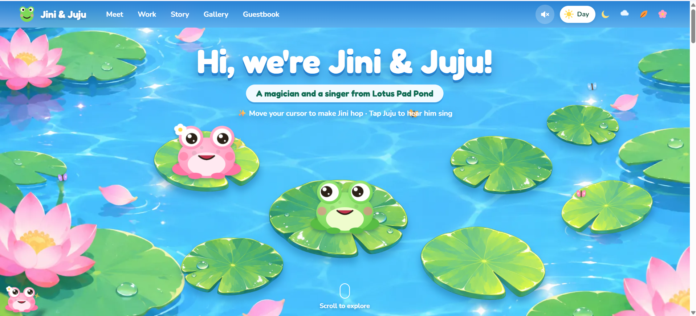
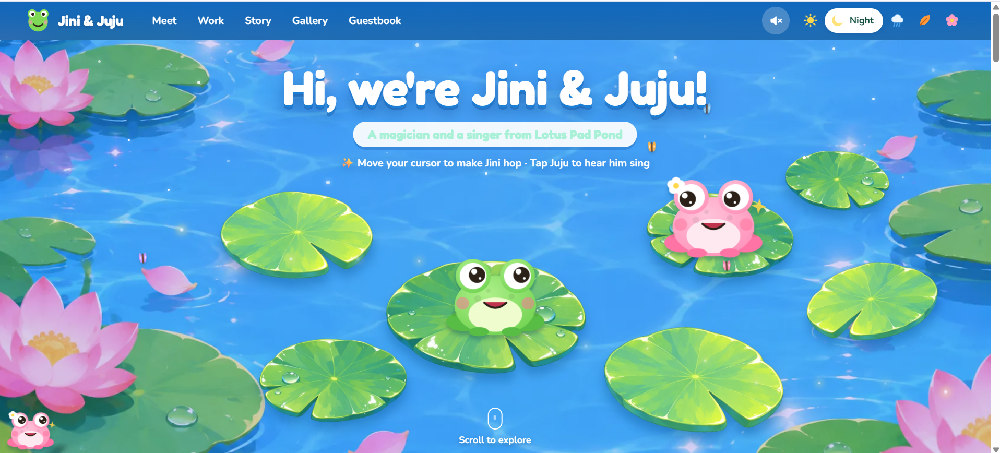
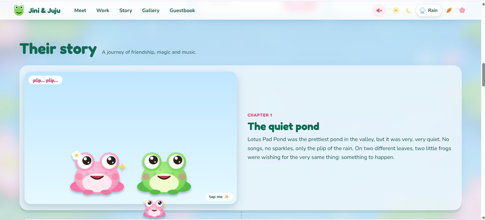
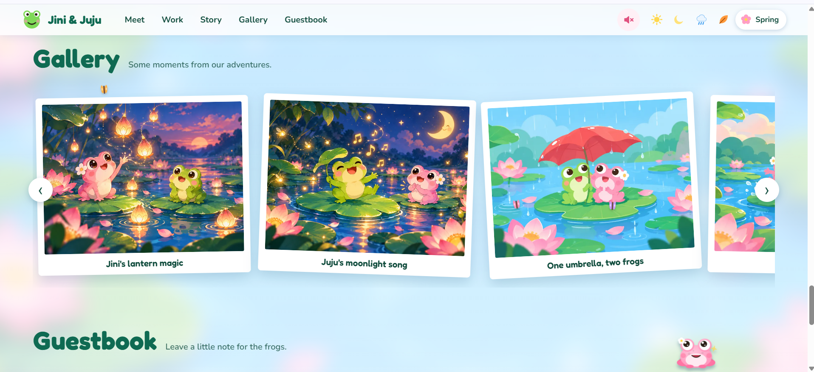
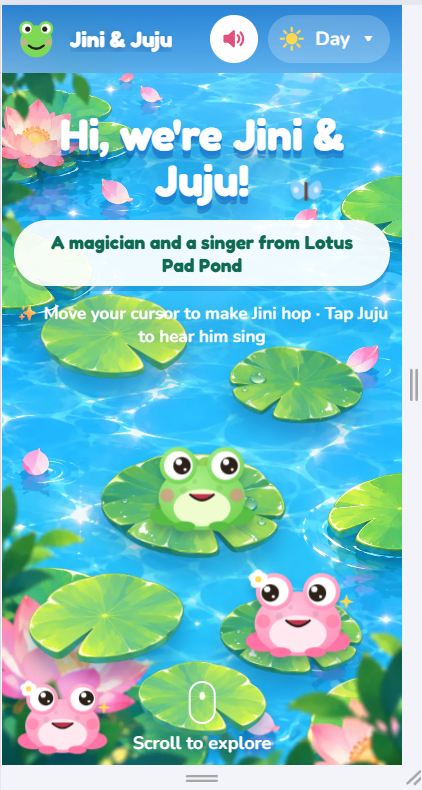

# 🐸 Jini & Juju: Baby's First Portfolio

**Live site:** `PASTE-YOUR-VERCEL-LINK-HERE`

My entry for **haX.baby: Baby's First Website** (17–19 October 2026), **Track 2: Your Own Baby**.
It is a cute, animated portfolio for two original characters who live on Lotus Pad Pond.

## Screenshots
<!-- Put your screenshots in the `screenshots/` folder with these exact names. Delete this section if you skip them. -->
| Day mode | Night mode |
| --- | --- |
|  |  |
|  |  |

| Mobile |
| --- |
|  |

## Meet the babies
- **Jini**, a pink magician frog. She turns raindrops into tiny wishes.
- **Juju**, a green frog and the pond's singer. He sings lullabies to the lotus flowers.

The page answers the three questions of the brief:
1. **What they are:** hero + "Meet the frogs" character sheets (species, personality, quirk, voice, job).
2. **What they do:** three playable projects: *Rain Xylophone*, *Wish Lanterns*, *Firefly Catcher*.
3. **Their story:** six scroll-reveal chapters (each under 150 words).

## Features
- **Hero:** Jini hops after your cursor from lily pad to lily pad (dotted arc, ripples, sparkles). Both frogs' eyes follow the cursor and blink. Tap Juju to hear him sing.
- **Five moods:** Day, Night, Rain, Autumn, Spring. Each changes the tint, weather particles and sound (rain mode has a soft rain loop).
- **Sound:** every sound is synthesised with the Web Audio API (no audio files). Off by default, with a speaker toggle in the navbar. Buttons and links make a small click.
- **Playable projects:** a pentatonic raindrop xylophone, a wish box (type a wish and it floats up in a lantern), and a firefly-catching game.
- **Gallery:** polaroid strip with arrows and a full-screen viewer (keyboard arrows and Esc work).
- **Guestbook:** leave a sticky note (saved in your own browser with `localStorage`).
- **Extras:** sparkle cursor trail, butterflies drifting around the sections, and a little Jini who hops along the bottom while you scroll.
- **Responsive:** separate portrait/landscape pond images and lily-pad layouts, mode dropdown on small screens.

## Hidden Easter egg 🥚
Tap Juju five times in a row. Spoiler: hearts!

## Tier / side quest checklist
- Tier 1: cursor eye-tracking, scroll-driven story, mood toggle, responsive, Easter egg ✅
- Tier 2: Web Audio synthesiser (xylophone, singing, chimes), interactive toys ✅
- Side quests: sparkle cursor trail ✅, click sounds + mute toggle ✅
- Not done (on purpose): 3D model, AI chat, live (server) guestbook, hit counter

## Tech stack
React 19 + Vite, Framer Motion (hop animation), plain CSS, Web Audio API, deployed on Vercel.

## Run it locally
```bash
npm install
npm run dev
```

## How it works (short)
- `src/components/Scene.jsx`: lily-pad layouts are percentages of the hero, so they work on any screen. On pointer move the nearest pad is picked and Framer Motion animates Jini there, with squash and stretch keyframes and an SVG dotted arc.
- `src/components/Frog.jsx`: SVG frog; a `pointermove` listener turns the cursor position into a pupil offset.
- `src/audio.js`: small oscillator + gain envelope helper; a global mute flag guards everything.
- `src/components/Work.jsx`, `Gallery.jsx`, `Guestbook.jsx`: the interactive sections.

## Credits and honesty
- Background, lily pads and gallery pictures were generated with an AI image tool and then optimised (WebP) and animated by me.
- I built the site with an AI pair programmer (Claude) and went through the code to understand and adjust it.
- No third-party audio, fonts are Fredoka and Nunito from Google Fonts.

Made by **Shreya Kushwaha**.
